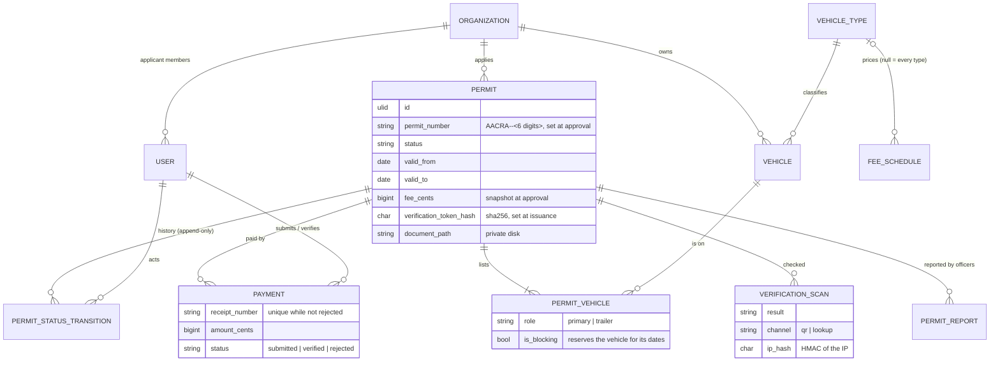
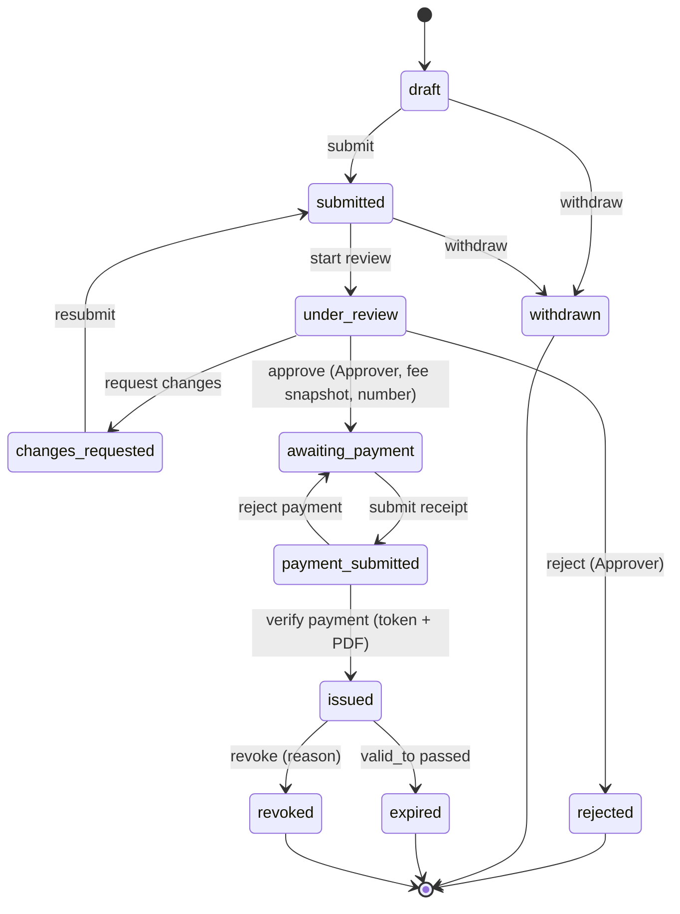
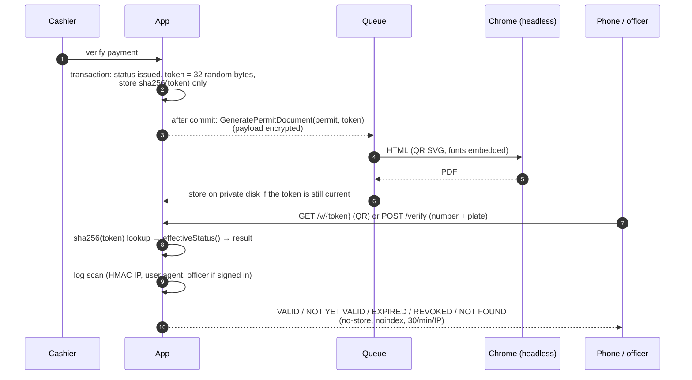
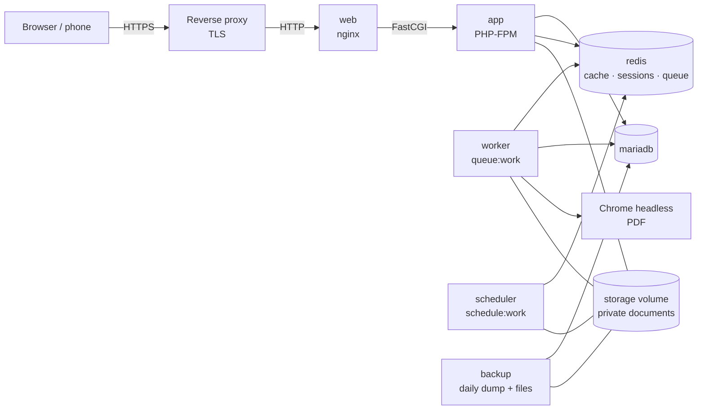

# Architecture

How the permit system is put together. Decisions and assumptions are in
[DECISIONS.md](DECISIONS.md); what each milestone built is in [plans/](plans/).

## Layers

```
HTTP (thin controllers) → FormRequest (validation, authorisation) → DTO (App\Data)
    → Action (App\Actions, one per state change, inside a DB transaction)
        → Domain services (App\Domain: state machine, overlap guard, fees, tokens, verifier)
            → Eloquent models → MySQL / MariaDB
Policies (App\Policies) decide who; the state machine decides when.
Resources (App\Http\Resources) are explicit whitelists of what reaches the browser.
```

## Domain model



## Permit lifecycle

`active` is never stored: an `issued` permit is *active* on the days it covers and
*expired* after them (`Permit::effectiveStatus()`), so verification is right even before
the nightly job runs.



Every arrow is one Action calling `PermitTransitions::apply()`: lock the permit row, ask
`PermitStateMachine`, apply the Action's changes, save, re-sync `permit_vehicles`, append
a history row. Reissuing an issued permit records an `issued → issued` row.

## Verification flow



- The QR code holds only `https://{verify_url}/v/{token}`: no personal data, no ids.
- Reissuing rotates the token: the old QR code answers NOT FOUND at once, a stale PDF job
  does nothing, and the old file is deleted.
- Revoking changes the status; the next scan answers REVOKED (nothing is cached).
- The public page is server-rendered Blade and works without JavaScript. A signed-in
  traffic officer (or Admin) gets the Inertia officer view of the same scan, with
  history, recent scans, reports and a report form.

## Audit log and settings

```mermaid
flowchart LR
    A[Action<br/>ApprovePermit, VerifyPayment,<br/>ChangeUserRole, SystemSettings…] -->|in the same transaction| H[(permit_status_transitions)]
    A -->|AuditLog::record| L[(activity_log<br/>append-only triggers)]
    A -->|after commit| N[Notifications<br/>mail · SMS]
    A -->|after commit| T[SendTelegramMessage job]
    S[(settings)] -->|boot + every queued job| C[config&#40;&#41;]
    C --> A
```



- Actions record who, what, before and after; database triggers refuse updates and deletes.
- Saved settings override `config()` keys; secrets are encrypted with `APP_KEY`.

## Deployment



`/up` checks the database, the cache and the queue. Errors go to Sentry when a DSN is set.

## Phase 2: offline verification (designed, not built)

For roadside checks without a network, the QR code would carry a compact signed payload
next to the online address:

- Payload (CBOR or a fixed binary layout, then base45 for an alphanumeric QR):
  permit number, plate(s) normalised, valid_from, valid_to, permit type, issued_at, key id.
- Signature: Ed25519 (`sodium_crypto_sign_detached`) by a key held only by the issuing
  server; officer apps ship the public keys, rotated by key id.
- The officer app verifies the signature and dates offline, and shows "signature valid,
  status unknown — revocation not checked" until it can sync a revocation list
  (permit numbers revoked since the last sync).
- Consequences to accept: a revoked permit still verifies offline until the next sync;
  the payload makes the QR code denser (error correction must stay ≥ M).

Nothing in the current schema blocks this: tokens and documents are already rotated per
issuance, and the verifier is a single service.
